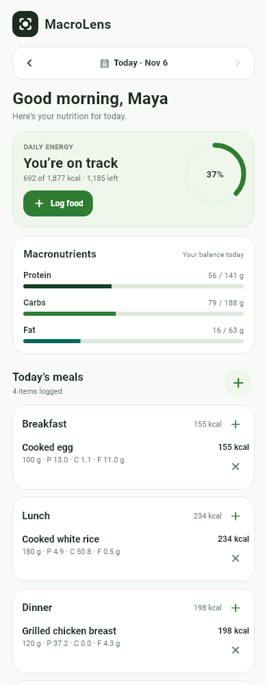
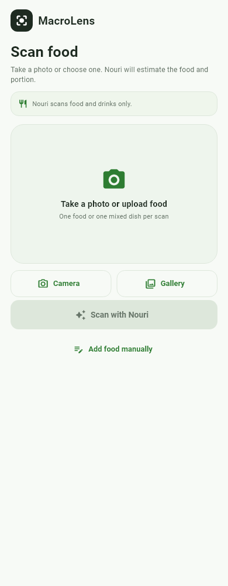
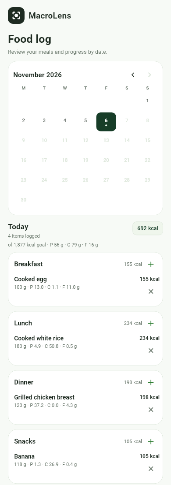
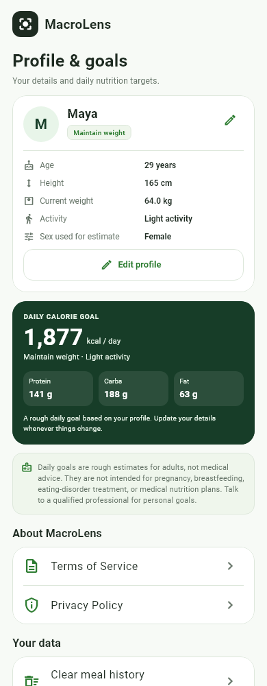

# MacroLens

MacroLens is a Flutter Android app for tracking calories, protein, carbohydrates, and fat. Its friendly food scanner is **Nouri**. You can log food from an on-device catalog, enter a custom food from its serving label, or photograph a meal and ask Nouri for a visual food and portion estimate.

The UI follows the six supplied screens: Login, Registration, Home, Scan, Logs, and Profile. It uses the later green direction — pale-green and off-white surfaces, dark-green actions, and readable dark text. The original orange palette is not used.

## Preview

| Today | Scan | Food log | Profile |
| --- | --- | --- | --- |
|  |  |  |  |

These are widget-rendered previews using Roboto and Material Icons with sample data, not device screenshots.

## What works

- **Login and registration** with Sign In / Create Account tabs, full name, email, password, a clearly labeled local demo login, Terms of Service and Privacy Policy links, and a forgot-password screen that honestly explains that this demo cannot send reset emails.
- **First-run profile setup** for name, age, sex used for the estimate, height, current weight, goal, optional goal weight, activity level, and the calorie-estimate setting. Profile details stay on the device and are never included in a scan.
- **Plain-language daily goals** for adults, with a daily calorie goal and protein/carbohydrate/fat grams. The calculation is in code; the interface does not show formula names, multipliers, adjustments, or percentage breakdowns. Goals are hidden for users under 18 and are not presented as suitable for pregnancy, breastfeeding, eating-disorder treatment, or medical nutrition plans.
- **Today dashboard** with a daily-energy card and status, a log-food shortcut, calorie ring, macronutrient bars, meal summaries, a Smart Scan card, and a weekly average chart. Calendar/date navigation shows the selected day's data, and totals update immediately after adding or removing food.
- **Food log** with a month calendar showing days that have entries, selected-day calorie and macro totals, meal sections with subtotals, remove with undo, add-per-meal, and monthly daily-average / days-logged cards.
- **Food catalog and custom food** search, correction of an AI match, grams/ounces input, and a custom-food flow based on “nutrition per serving” rather than asking everyday users to calculate per-100-g values. Internally every nutrient is stored per 100 g and every logged amount is calculated as `per-100-g value × portion grams ÷ 100`.
- **Nouri scanner** with camera and gallery actions, preview, hosted DeepSeek analysis, one primary food or combined dish, an edible-gram suggestion with a low/high visual range, adjustable grams/ounces, meal type, source selection between the local catalog and Nouri's estimate, and a nutrition preview before adding. Invalid, non-food, unsupported, offline, slow, and provider-error cases show simple messages and a manual-entry fallback.
- **Local persistence** of the demo sign-in, profile, and meal history. Clear meal history is available in Profile; uninstalling clears local data. No account backend or cloud database is connected.

## Login, authentication, and privacy

Authentication is a **local demo**, not a real account service. Email and password are validated only on the device; they are not transmitted, verified, or stored. A device-only flag remembers the demo sign-in. The forgot-password flow does not send email or reset a password because no account service exists.

Profile and meal history are stored in local app preferences. They are not uploaded to the scanner. A scan sends only the selected photo (plus the private scanner token) to the hosted scanner.

See [docs/PRIVACY_POLICY.md](docs/PRIVACY_POLICY.md) and [docs/TERMS_OF_SERVICE.md](docs/TERMS_OF_SERVICE.md). The in-app legal screens mirror these prototype disclosures.

## DeepSeek scanner backend

The FastAPI service is in `backend/` and is deployed with the included Render Blueprint.

### Routes

- `GET /health` → `{"status":"ok"}`
- `POST /api/analyze` → multipart form with an image field named `image`; optional `x-scanner-token` header when `SCANNER_ACCESS_TOKEN` is set.

The backend uses the current DeepSeek vision model **`deepseek-flash`** through the OpenAI-compatible Chat Completions endpoint at `https://api.deepseek.com/chat/completions`. The image is sent as a base64 data URL with `detail: "high"`. JSON Output is requested with `response_format: {"type":"json_object"}`, a prompt that contains the word “json,” a format example, and `max_tokens` to reduce truncation.

Official references used for this implementation:

- [DeepSeek Vision guide](https://api-docs.deepseek.com/guides/vision/)
- [DeepSeek JSON Output guide](https://api-docs.deepseek.com/guides/json_mode/)
- [DeepSeek privacy policy](https://cdn.deepseek.com/policies/en-US/deepseek-privacy-policy.html) (last updated February 10, 2026)
- [DeepSeek Open Platform Terms of Service](https://cdn.deepseek.com/policies/en-US/deepseek-open-platform-terms-of-service.html)

### Provider behavior

- Supported formats: JPEG, PNG, GIF, and WebP. HEIC/HEIF is rejected with a clear message instead of being sent as an unsupported format.
- Image size limit: 15 MB. DeepSeek's per-image and request-body limits are larger, so this stays comfortably inside them.
- The backend detects the actual image signature rather than trusting the upload MIME. The app's picker is limited to JPEG/PNG/GIF/WebP as well.
- The model must return one primary food or one combined dish. The backend validates and cleans every field: food name, confidence (capped below 1.0), portion guess, low/high range, and per-100-g nutrition. Non-food and unclear results are rejected. Malformed or truncated JSON is rejected.
- Portion bounds are widened when needed so a scan is never presented as a measured weight.
- Provider status codes map to simple app messages. API keys, access tokens, and image bytes are not logged. Responses use `Cache-Control: no-store`.

Example validated response:

```json
{
  "food_detected": true,
  "items": [
    {
      "food_name": "Grilled chicken breast",
      "confidence": 0.82,
      "portion_guess_g": 180,
      "portion_low_g": 80,
      "portion_high_g": 230,
      "nutrition_per_100g": {
        "calories_kcal": 165,
        "protein_g": 31,
        "carbs_g": 0,
        "fat_g": 3.6
      }
    }
  ],
  "clarification": ""
}
```

### DeepSeek privacy note

The DeepSeek API receives the submitted photo and prompt. DeepSeek's privacy policy states that it collects user inputs, may use them to improve and train its technology, retains personal data as long as necessary for its services and legal obligations, and may process data outside the user's country, including in the People's Republic of China. MacroLens does not claim a zero-retention mode or that DeepSeek will not review submitted content. Do not scan sensitive, confidential, or personal images.

## Run on an Android phone from Windows

Requirements: Flutter 3.47+ with Android tooling, a USB data cable, and a phone with **Developer options → USB debugging** enabled.

1. Create the private build config from the example:

   ```powershell
   Copy-Item private_config.example.json private_config.json
   ```

   Set `MACROS_API_URL` to the hosted scanner endpoint, for example `https://YOUR-SERVICE.onrender.com/api/analyze`, and `SCANNER_ACCESS_TOKEN` to the same token configured in Render. Keep `private_config.json` private; it is ignored by Git. A secret compiled into a demo APK is extractable and is not a production security boundary.

2. Install dependencies and check the phone:

   ```powershell
   flutter pub get
   flutter devices
   ```

3. Build, install, and launch on the connected phone:

   ```powershell
   flutter run --dart-define-from-file=private_config.json
   ```

Once installed, scanning uses the phone's own internet connection. The laptop, USB cable, and local Wi-Fi are not required after installation.

To build an installable debug APK instead:

```powershell
flutter build apk --debug --dart-define-from-file=private_config.json
adb install -r 'build\app\outputs\flutter-apk\app-debug.apk'
```

Release builds require HTTPS. Debug builds allow cleartext only for local development (loopback/private LAN addresses); the hosted scanner should use HTTPS.

## Start the backend locally

From `backend/`:

```powershell
python -m venv .venv
.\.venv\Scripts\Activate.ps1
pip install -r requirements.txt
$env:DEEPSEEK_API_KEY="your-deepseek-key"
$env:SCANNER_ACCESS_TOKEN="a-private-local-token"  # optional locally
uvicorn main:app --reload --host 0.0.0.0 --port 8000
```

For the Android emulator, set `MACROS_API_URL` to `http://10.0.2.2:8000/api/analyze`. For a physical phone on the same network, use the laptop's LAN address in a debug build. Never put a DeepSeek key in Flutter source, a Dart define, a committed file, or the APK.

## Set `DEEPSEEK_API_KEY` on Render

1. Open the Render dashboard and select the `macrolens-scanner` service created by `render.yaml`.
2. Open **Environment**.
3. Add a secret environment variable named `DEEPSEEK_API_KEY` with the API key from the DeepSeek platform. Do not paste it into GitHub, `private_config.json`, or the app.
4. Confirm `SCANNER_ACCESS_TOKEN` is also present and matches the token in your private Flutter build config.
5. Save the changes. Render redeploys the service. Check `https://YOUR-SERVICE.onrender.com/health` for `{"status":"ok"}`.
6. Remove any old `GEMINI_API_KEY` variable from the service.

Render's free web services can sleep after inactivity; the first scan may take up to about a minute while the service wakes. The app shows a cold-start message and manual fallback.

## Checks

```powershell
flutter analyze
flutter test
```

From `backend/`:

```powershell
python -m unittest -v
```

The Flutter suite covers nutrition scaling, profile targets, catalog matching, scanner response validation, local persistence, onboarding, forgot-password, registration, plain-language profile UI, custom-food serving conversion, scanner privacy, and narrow-phone layouts (320 px at 1.3× text). The backend suite covers validation, image signatures (including GIF and HEIC rejection), auth, health, DeepSeek request shape, JSON parsing, rate limits, timeouts, and API error mapping with mocked provider calls.

## Project layout

```text
lib/
  main.dart                  app state, demo session, tabs, local persistence
  models.dart                Food, MealEntry, HealthProfile, portion units
  catalog.dart               local per-100-g catalog and food matching
  storage.dart               SharedPreferences profile/session/log storage
  scanner_service.dart       compile-time config, HTTP client, response validation
  theme.dart                 green palette and Material 3 theme
  screens/                   login, registration pieces, forgot password, Today, scan,
                             food log, profile, manual add, picker, legal
  ui/common.dart             cards, month calendar, week strip, food rows, nutrition tiles
backend/
  main.py                    FastAPI routes and DeepSeek request
  validation.py              stdlib-only response/image validation
  test_api.py                mocked API/provider tests
  test_validation.py         validation tests
docs/                        privacy policy, terms, screenshots
render.yaml                  Render Blueprint
```

## Prototype limitations

- Authentication is a local demo, not a real account system. There is no secure account storage or password reset service.
- Nutrition data is a small sample catalog plus generic AI estimates, not a comprehensive verified database.
- Photo portions, ranges, and macros are estimates, not measurements. Nouri can misidentify food or a portion.
- Daily goals are rough adult estimates. They are hidden for users under 18 and are not suitable for pregnancy, breastfeeding, eating-disorder treatment, or medical nutrition plans.
- The hosted scanner depends on Render and DeepSeek availability. The first scan after idle can be slow.
- A scanner access token compiled into a private demo APK is extractable; rotate it after sharing a build externally.
- The DeepSeek API key must remain a backend secret. A real DeepSeek scan was not run in this environment; provider calls are mocked in tests.
- The prototype has not had a production security or legal review.
